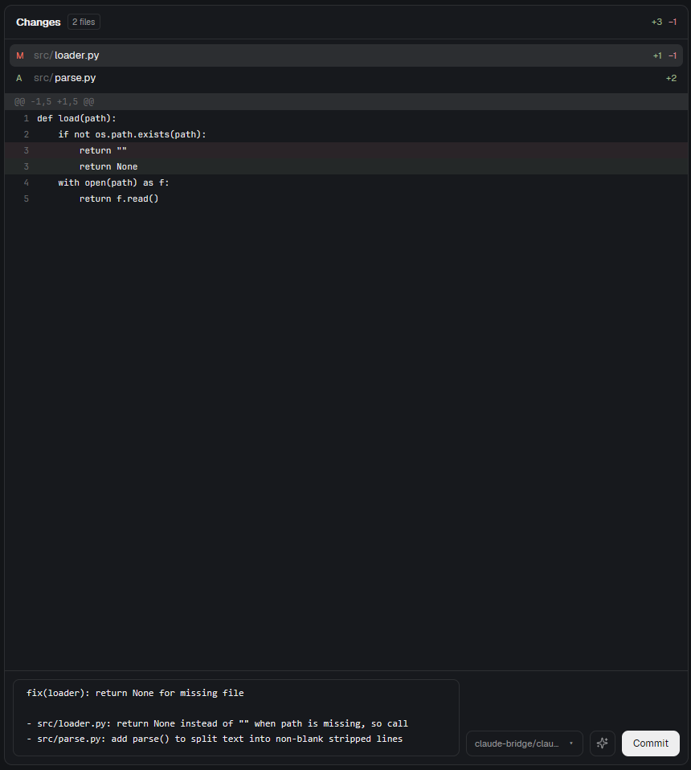

# AI commit message



A Changes panel for Herdr with an AI button for the commit message. It is the commit half of a Git panel: it shows what is staged, and next to the commit box it has a model button and a sparkles button. The model button opens a menu of what can write the message, and the sparkles button reads the diff and fills the commit box with one Conventional Commits subject line.

Out of the box it asks the agent you already use — Claude Code, Codex, Gemini, Copilot or Pi — in its non-interactive mode, with the logins it already has, so there is nothing to configure and no key to paste. Adding an `ai` section to `settings.json` replaces that with exactly the providers you list, including Anthropic, OpenAI-compatible servers, Ollama and any other agent CLI.

Someone who installs this and configures nothing sees one line per agent installed on their machine — "Claude Code", "Pi", "Codex", "Gemini", "Copilot" — with the heading 'No "ai" in settings.json: the agents you already have'; the button shows the first and the sparkles button asks it. No key, no model list, no third-party endpoint. If no agent is installed, the menu says 'Nothing to ask: install an agent (claude, codex, gemini, copilot, pi) or add "ai" with a provider'. An API provider (and its key) appears only because the person wrote it in `settings.json`.

It is built to work with a staging panel, not to replace one: stage files in Changes (for example Changes Plus, `miriarte33/herdr-changes-plus`), and this panel writes the message for what is staged and commits exactly that. `mod.json` says `{"place": "none"}`, so nothing docks by itself. Put it where the Changes panel goes in a layout:

```json
{ "id": "changes", "type": "block", "content": { "mod": "ai-commit" } }
```

`herdr-app do mod.open ai-commit` opens the same panel as a floating one, to try it before touching a layout (again closes it).

**What you see:** a card with a header ("Commit", staged file count, +/− totals), the list of staged files (status letter, folder in grey, file name, added and removed counts), a note line for messages and errors, and a footer with the commit box, the model button, the sparkles button and the Commit button. It has no diff viewer: the staging panel shows diffs. The model button is 32 px tall and shows the model label (truncated to about 110 px). The sparkles button is 32×32 px. The model menu opens over the panel, above the footer, sized to the panel (300 px wide, at most 360 px tall, smaller in a small panel).

**How it behaves:**
- The staged list refreshes when the folder changes and every 10 seconds (every 30 seconds on remote spaces, since each refresh runs Git over SSH). On a local folder a watch refreshes it sooner.
- Only staged files count. Unstaged and untracked files are not in the message and not in the commit.
- An agent can think out loud before answering, so its output is not taken at face value: the subject is the last line shaped like `type(scope): subject`, and Claude Code is asked for JSON, where only the final message is (`result`). A line of the agent's own plan never reaches the commit box.
- Model button (the name with ▾, or Escape to close): opens a menu of the providers with ✓ on the selected one. An agent is a single line with its name. An agent shows its own name and one entry, "default (its own model)"; an API provider lists the models it reports (see below). Lists are fetched when the menu is first opened. Clicking an entry selects it for the sparkles button; the choice is kept in shared state (`ai-commit.selected`) and shown again when the panel opens.
- Sparkles button (or the keyboard command below): the button spins and the note line says "AI: generating commit message…". On success the subject appears in the commit box. With no `ai` section the first installed agent is used. If the subject is over 50 characters, the mod asks the model once more for a shorter one; if the result is still long, the note says how many characters it has. If the diff is longer than the provider can take (60,000 characters for an API provider, less for an agent), the note says it was truncated. A request that has not answered after 3 minutes is given up on (the note says so and the button works again); a reply that arrives later is dropped.
- Failures show a reason in the note line, in red: no configuration, missing key, HTTP status, empty reply, no repository, no changes. Informational notes (truncation, subject length) are shown in grey and disappear on the next file click or commit.
- If you switch repositories while a message is generating, the result is dropped.
- A commit already running blocks generation with "AI: a commit is in progress".
- The commit box is multi-line. The sparkles button fills it with a subject, a blank line and a body of 2 to 4 short bullets (saying what changed and why). Enter adds a line; the Commit button commits. The box shows about four lines and scrolls for the rest.
- Commit runs `git commit -m <subject>` and, when there is a body, `-m <body>`, so git keeps the paragraph. It never runs `git add`: with nothing staged it refuses and says so.

**Keyboard:** next to the mod, `keys.json` holds the key it expects:

```json
"mod:ai-commit": { "ctrl-alt-g": "ai-commit.generate" }
```

Merge that section into `~/.config/herdr-app/keys.json` (ask before replacing a key that is already used). The section name is the mod's folder name, so it has to be renamed if the folder is. Herdr delivers the command to the panel as `generate`.

**Built from:**
- One mod, `mods/ai-commit/`: `main.js` (the panel), `mod.json` (`"place": "none"` and an overlay, so nothing docks by itself and `mod.open` shows it floating) and `sparkles.svg` (the icon, tinted with the text color). Next to that folder there are `keys.json`, `RECIPE.md` and `preview.png`, and no `layouts/` folder.
- Built from the shipped `changes` panel's commit box and model code; the staged list and the AI code are its own. Nothing is copied from the diff viewer any more.
- `herdr` functions: `exec` (Git with `on:` for remote spaces; the agent CLIs; `printenv`/`powershell` only to read an environment variable named in `api_key_env`), `readTextFile` (reads `settings.json` in the app home, and a changed file's text for the preview and for the AI), `knownAgents` (which agents are installed here, for the no-configuration case), `appHome`, `watchFolder`, `theme`, `settings`, `shared` / `setShared`, `nextCommand`, `focused`, `spaces`, `panes`, `cx.spawn`, `cx.timer`, `cx.focus_handle`.
- Commands: none. The mod never calls `run(...)`.
- Programs it runs: `git` (status, diff, add, commit; `git --no-optional-locks` with fsmonitor and index refresh off, so a refresh does not write under `.git` and wake the folder watch); `printenv` then `powershell` to read a key from the environment (`powershell` only where `printenv` is not there, such as Windows); and, for an `agent` provider, that agent's CLI in its non-interactive mode, with its own logins:
  - `claude` → `claude -p --output-format json <prompt>` (plus `--model <m>` when one is chosen); the answer is read from its `result`
  - `pi` → `pi -p --no-session --no-tools --no-context-files <prompt>`; `pi --list-models` for the menu
  - `codex` → `codex exec --skip-git-repo-check --sandbox read-only <prompt>`
  - `gemini` → `gemini <prompt>` (plus `-m <m>`)
  - `copilot` → `copilot -p <prompt>`
  - any other CLI, through `"command": ["…"]` in `settings.json`, with the prompt as the last argument
  On Windows several of these are `.cmd` shims that a direct spawn does not find by their bare name (and a batch file cannot carry a line break): the mod retries `<name>.cmd` and hands it the prompt on one line, with each line break written as ⏎ (one character, so flattening does not grow the prompt).
- Network: an `agent` provider reaches the network through that agent, which is already logged in; the mod itself makes no request for it. For an API provider, `fetch` to its endpoint: `https://api.anthropic.com/v1/messages` for `anthropic`; `<base_url>/chat/completions` for `openai` (default `https://api.openai.com/v1`); `<base_url>/api/chat` for `ollama` (default `http://127.0.0.1:11434`); the model list from `/v1/models`, `<base_url>/models` or `/api/tags`.
- What the AI is sent: the staged diff only (`git diff --cached`), biggest file first, so a cut keeps the code and not a license file. An API provider gets 60,000 characters of it; an agent gets what is left of a 7,600-character prompt once the instructions and the file list are in, because the prompt has to fit a command line (~8,191 on Windows). The note line says when that happened.
- Files read outside the mod folder: `<app home>/settings.json` (the `ai` section; read on every click and every timer tick) and files in the repository being previewed or summarized.
- Files written: none. The mod never writes a file, in the repository or in the app home.

**Configuration** — none, or `~/.config/herdr-app/settings.json`:

With no `ai` section the panel offers the agents that are installed here and already logged in, from Herdr's own agent table (`knownAgents()`), and uses the first one. Nothing else is needed:

```json
{ "zoom": 1 }
```

To choose, or to add a provider, write the list yourself. An agent needs no key; the rest of the example shows the API providers:

```json
"ai": {
  "default": { "provider": "Claude Code" },
  "providers": [
    { "name": "Claude Code", "provider": "agent", "agent": "claude" },
    { "name": "My tool", "provider": "agent", "command": ["mytool", "--print"] },
    { "name": "Anthropic", "provider": "anthropic", "api_key_env": "ANTHROPIC_API_KEY" },
    { "name": "Local server", "provider": "openai", "base_url": "http://localhost:8000/v1" },
    { "name": "Ollama", "provider": "ollama" },
    { "name": "Ollama cloud", "provider": "ollama", "base_url": "https://ollama.com", "api_key_env": "OLLAMA_API_KEY" }
  ]
}
```

- `provider` is what answers: `agent` (a CLI that is already logged in), `anthropic`, `openai` (any OpenAI-compatible server: OpenAI, SGLang, vLLM, LM Studio…) or `ollama`.
- For an `agent`, `"agent"` names one the mod knows: `claude` (Claude Code), `pi` (Pi), `codex` (Codex), `gemini` (Gemini), `copilot` (Copilot). For anything else, `"command": ["…"]` runs that program with the prompt as the last argument, so any agent with a non-interactive mode works. `"provider": "pi"` is still accepted and means `agent` + `pi`.
- An agent uses its own login and its own model: add `"model": "…"` only to pin one (`--model`, `-m`, …), and note that only `pi` can list its models (`pi --list-models`); the others show one entry, "default (its own model)". `pi --list-models` reports every provider pi knows, and the plain API and a bridge often carry the same Claude models: a long list there is pi's catalog, not a wrong setup. Use `"filter"` or `"model"` below to show only what you use.
- An API provider lists the models its endpoint reports: Anthropic's `/v1/models`, `<base_url>/models` for `openai`, Ollama's local list (embedding models are left out). Ollama: `/api/tags`. For the Ollama cloud catalog, add a second provider with `"base_url": "https://ollama.com"` and an `api_key_env` (chat with the cloud needs a key from ollama.com).
- To fix the model of a provider instead of listing them, add `"model": "…"` to it; it then shows as the only entry. To keep a provider's long list short without pinning one, add `"filter": "claude-bridge/*"` (a `*` wildcard; `"*sonnet*"` or an exact name also work) and only the matching models are listed.
- Keys, for API providers only: `api_key` (in the file) or `api_key_env` (an environment variable name; the file then holds no secret). `ollama` needs none; `openai`-compatible servers take an optional key.
- Anthropic needs a console API key. An agent provider never needs one: it goes through the CLI, which is already logged in.
- Older files with `"models": [{label, provider, model}]` still work.

**Watch out:**
- Keys in `settings.json` are plain text. Prefer `api_key_env`, and don't commit that file.
- An agent provider runs another program: that CLI must be installed and logged in. When it is not, the note line and the menu show what the CLI said (a stale Codex token, Gemini asking for `GOOGLE_CLOUD_PROJECT`, a Copilot organisation policy) — the mod cannot fix that, and there is nothing to configure in `settings.json`.
- The model may still return a subject longer than 50 characters after the retry. The note says so; edit it before committing if needed.
- The body is what the model wrote: 2 to 6 lines, each cut at 72 characters. It is not checked against the diff, so read it before committing. A body that the model did not write is left empty; the subject still comes through.
- Sending the diff to a third-party model means the code leaves your machine. Use a local agent, `ollama` or a local `openai`-compatible server if that is not acceptable. This includes untracked files, which are sent as text.
- Agents listed by `knownAgents()` are installed, not necessarily usable: Herdr's installed check runs through your shell, while a CLI can still refuse for its own reasons. Pick the one you know works; the failure is only visible when it is asked.
- A provider whose key is missing is reported inside its block in the model menu ("environment variable ANTHROPIC_API_KEY is not set", or "no Anthropic API key"), in red. That is configuration, not a crash: the other providers still list their models, and a provider with `"model": "…"` never asks for a list. The mod never reuses another program's credentials for a plain API provider; only the `pi` provider uses pi's logins, because it runs pi itself.
- The catalog is fetched once per panel session: a provider that failed keeps its message until the panel is closed and opened again (or the app restarts).
- A hung endpoint is only abandoned after 3 minutes; there is no cancel button.
- Reasoning models (for example Qwen through SGLang) can put their reasoning in a separate field. The mod uses only the text reply.
- The panel is a copy of the Changes panel, so a layout that already has `changes` shows two panels unless one is removed or the block points at this mod instead.
- The model menu is drawn inside the panel, so it never grows beyond it: in a short panel it is short, and it scrolls with the wheel. Escape closes it.

**Done when:**
- `herdr-app check mods/ai-commit` passes.
- With no `ai` section, the model button shows an installed agent (Claude Code, Pi, …) and the sparkles button fills the box without any key.
- With an `ai` section, the model button shows its default; the menu lists what each provider offers and the chosen one gets ✓.
- Clicking a file in the list shows that file's diff (the list still works with the model menu present).
- With a staged change, the sparkles button fills the commit box with a `type(scope): subject` line.
- With only untracked files, it still fills the box (they are part of the diff it reads).
- With nothing changed, the note line says "no changes to summarize".
- With an `anthropic` model and no key, the note line says "no Anthropic API key".
- With a subject over 50 characters, the mod asks again and the note shows the length if it is still over.
- The keyboard command generates the same message as the button.
